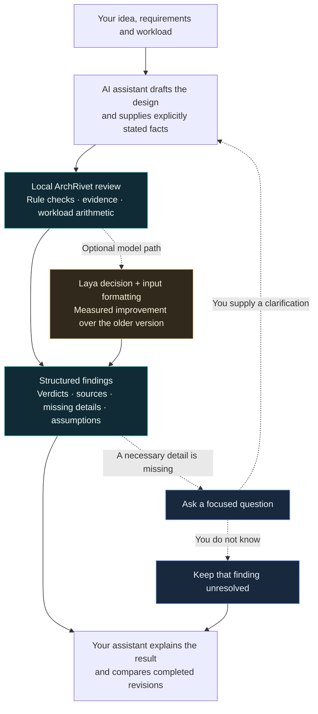

<picture>
  <source media="(prefers-reduced-motion: reduce)" srcset="docs/assets/archrivet-icon-512.png">
  
</picture>

# ArchRivet

### Give your system design a second look, inside your AI assistant.

Find missing details. Check backend risks. See what changes after a clarification.

**[Download](https://github.com/Ujjansh05/archrivet/releases/tag/v0.3.0a2) · [Quick start](#try-it) · [Demo](#one-question-changes-the-review) · [How it works](#how-it-works) · [Benchmarks](#measured-improvement)**

ArchRivet is an open-source, local **MCP plugin for system-design reviews**. Your assistant drafts and explains the architecture. ArchRivet reviews the supplied facts and returns findings, evidence, calculations, and specific questions to ask next.

| Find the gap | Understand the risk | Check the revision |
|---|---|---|
| Get the exact missing detail to supply. | See the affected requirement and supporting references. | See which changed fact changed the finding. |

Useful for product backends, payment flows, caches, notifications, and system-design discussions. Start with local rules; optionally enable the **322M Laya model**.

**Best first use case:** review a backend flow before building it. For example, describe how an order enters a queue, when the API confirms it, and what a worker does before acknowledging it. ArchRivet checks whether the stated flow covers retries, durability, and overload. If a detail is missing, it asks for that detail. Your assistant can then propose a fix and call `preview_proposal` to see which checks the proposal *would* satisfy if its assumptions hold. The preview is conditional, not a deployment test.

**Solo-builder early access:** you can try the rules-based plugin without assembling a team of reviewers. Please share a redacted design, expected result, and tool result through a [feedback issue](https://github.com/Ujjansh05/archrivet/issues/new/choose). Real-world feedback will guide the next checks; current synthetic benchmarks do not prove better design quality in every case. [Claude launch and installation options](docs/claude-launch.md).

**New in 0.3.0a2:** a lighter rules download, clearer model-loading status, and confirmation questions when the assistant's interpretation cannot be checked against the source. A matching quote alone never verifies its meaning. [What changed and how to verify it](docs/reliability-preview.md).

## One question changes the review

**Development preview: live diagrams.** Open a flowchart beside your assistant, see components change as the AI updates its design, and close the viewer independently. This checkout adds the viewer; the published v0.3.0a2 download does not include it yet. [Try the walkthrough and see host compatibility](docs/live-diagram.md).

> “Prices must be less than five seconds old. We serve cached prices during an outage.”

ArchRivet asks: **“During an outage, how old may a cached value become?”**

| What you supply | Rules-mode result | What you learn |
|---|---|---|
| Outage age limit not specified | `insufficient_information` | Name the missing outage-age bound. |
| “Up to 60 seconds” | `contradicted` | This exceeds your five-second requirement. |
| “Up to four seconds,” with the other declared bounds satisfied | `supported` | The supplied bounds satisfy this scoped check; verify them in the implementation. |

*Recorded with 0.3.0a1 in rules mode; timing is shortened. The newer version also asks you to confirm unresolved prose interpretations before using them. [Read the recorded example and answers](docs/demo-comparison.md).*

<strong>Compare Codex with and without the plugin</strong>

Codex found the missing detail in both runs. ArchRivet adds a structured result, named missing facts, and a checked comparison after clarification. This example does not establish an accuracy advantage over Codex.

## How it works

<picture>
  <source media="(prefers-reduced-motion: reduce)" srcset="docs/assets/archrivet-flow.png">
  
</picture>

*Illustrated flow of the recorded rules-mode example; animation timing is not response time. [View the still diagram](docs/assets/archrivet-flow.png).*

<strong>See the full flow and the stage covered by the model benchmark</strong>

The amber node identifies the optional model path measured below.

**The benchmark compares the optional Laya decision and its input format.** Rules and model disagreements stay visible in the combined review. Calculations estimate demand; tested production capacity requires a matching load test.

## Measured improvement

**The new Laya deployment improved over the previous model. Rules alone still score highest on this synthetic set.**

These are **synthetic final-test results for the optional Laya classifier**, comparing the previous release with the new preview on the same cases. They do not measure the whole assistant or accuracy on real production architectures.

| Measure — same 780 cases | Previous model deployment | Optional preview model | Rules alone |
|---|---:|---:|---:|
| Correct decisions | 294 / 780 | 769 / 780 | 780 / 780 |
| Accuracy | 37.7% | 98.6% | 100% |
| Incorrect approvals | 222 | 3 | 0 |
| Recognized missing-information cases | 64 / 260 | 259 / 260 | 260 / 260 |

An incorrect approval is a `supported` answer for a flawed or incomplete case. The improvement covers **model weights, input formatting, and context changes together**. The test shares synthetic mechanisms with training, has no independent human review, and still contains incorrect approvals. Strict release gates remain unmet; the model stays optional and experimental.

The finite cases closely match the rules. **Neither 100% nor 98.6% is a real-world accuracy claim.** This set does not demonstrate that adding Laya improves on rules or the host assistant. These public cases are now regressions, not an untouched test for future training. [Reproduce the rules baseline](docs/benchmarks/2026-10-preview.md#rules-baseline).

**[Full results and remaining failures](docs/benchmarks/2026-10-preview.md) · [780 test cases](docs/benchmarks/2026-10-final-test.jsonl) · [Raw results](docs/benchmarks/2026-10-preview.json) · [Reproduce the comparison](docs/benchmarks/2026-10-preview.md#reproduce-the-final-test-decision-counts)**

<strong>Watch the comparison and see CPU measurements</strong>

| CPU measurement | Previous | Preview |
|---|---:|---:|
| Median warm classifier call | 0.178 s | 0.299 s |
| Sampled process RAM | 1.62 GiB | 1.71 GiB |

One local pass on an i7-13700H: 16 decisions per version, FP32, four threads, one call at a time. These exclude first model loading and are not whole-review or AI-response timings. The new model was **more accurate on this test, but slower on CPU**. [Timing samples and cold-start observations](docs/benchmarks/2026-10-preview.md#response-time-and-memory)

## Try it

For complete local reviews of eight fixed checks, the current CPU measurements are **33 ms median in rules mode** and **2.39 s with Laya** after loading. These exclude the AI host's answer and do not establish an accuracy advantage. [Samples, p95, startup and RAM measurements](docs/benchmarks/2026-10-runtime.md).

| Your setup | Start here |
|---|---|
| Codex on Windows x64 | [Download lightweight rules ZIP](https://github.com/Ujjansh05/archrivet/releases/download/v0.3.0a2/archrivet-windows-x64-rules-0.3.0-alpha.1.zip), extract, then follow the [one-time connection steps](docs/quick-start-preview.md). |
| Desktop host supporting MCPB 0.4 with UV | [Download rules MCP extension](https://github.com/Ujjansh05/archrivet/releases/download/v0.3.0a2/archrivet-windows-x64-rules-0.3.0-alpha.1.mcpb) and install through the host's extension settings. |
| Optional Laya CPU model | Choose the **laya-cpu** bundle from the [release downloads](https://github.com/Ujjansh05/archrivet/releases/tag/v0.3.0a2), replacing the rules installation. |
| Claude Code early access | [Local plugin setup and public launch status](docs/claude-launch.md). The rules package needs no GPU. |

Start in **rules mode**: no Torch, Laya, model download or GPU is required. The separate Laya bundle uses CPU; the Python runtime also supports CUDA. Model weights are unchanged in this runtime update and remain a separate [release download](https://github.com/Ujjansh05/archrivet/releases/tag/v0.3.0a1).

Once connected, try:

> Review my design with ArchRivet. Use only stated facts. Name what is missing, ask the next useful question, then compare the review after I answer.

Windows x64 is the tested bundle platform. Compatible desktop hosts manage dependency setup; Codex needs a one-time setup command. Initial installation requires internet and disk space. A real Claude Desktop GUI test is still pending; this is a direct GitHub download, not an approved directory listing.

## Eight focused checks

| Design area | Question it helps review |
|---|---|
| Retries | Could trying an operation again repeat its effects? |
| Durability | Is success acknowledged only after the required data is safely stored? |
| Queues | What happens when work arrives faster than it can be processed? |
| Transactions | Could part of a multi-step change succeed while another part fails? |
| Replica reads | Can a read return data older than the requirement allows? |
| Caching | Could cached data exceed its allowed age, including during failures? |
| Failover | Could the old and new leaders both accept writes? |
| Dependencies | Can a slow downstream service exhaust the request's time budget? |

Your assistant maps your description to these checks. ArchRivet does not independently inspect your implementation or verify deployment behavior.

## Know what the answer means

“Supported” means the supplied facts satisfy a listed check. It does not certify the whole system. Unknown facts, rule/model disagreements, and source limitations stay visible. Workload calculations estimate demand; production capacity needs a matching load test. Model confidence is not production failure risk.

The assistant's prose interpretations require confirmation unless they match an explicit typed source declaration. Confirming a fact records your intended design; it does not verify deployed behavior.

ArchRivet runs checks locally. Your AI assistant still follows its own provider and conversation-storage settings.

OpenAI desktop submission preparation is tracked in the [submission checklist](docs/openai-submission.md).
The local package is a candidate for testing; organization approval, a real desktop
installation test and directory review remain pending.

[Report a problem](https://github.com/Ujjansh05/archrivet/issues) with a small example and the result you expected. Original code: [MIT](LICENSE). Models and references retain their [licenses and attribution](THIRD_PARTY_NOTICES.md).
