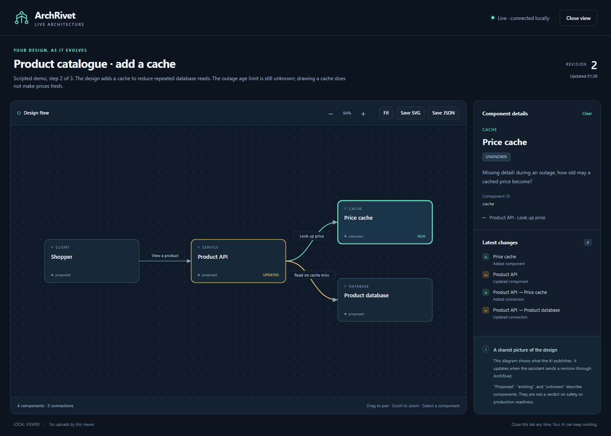

# Live architecture viewer (development preview)

Keep a flowchart beside your conversation. Your AI supplies the graph; ArchRivet displays the latest revision in a local browser window or tab. A database, API, cache, queue, client or external service can be shown without training another model.

This feature is in the separate `feature/live-architecture-view` checkout. It is not included in the published v0.3.0a2 download yet.



## Try the walkthrough

In the prepared Windows checkout, double-click **Open diagram preview.cmd**. It uses the existing Python environment and opens a local browser. The example adds a price cache after eight seconds and clarifies its age limit after another eight seconds. The walkthrough is scripted; it does not claim to demonstrate AI accuracy.

Alternatively, after installing this checkout:

```powershell
arch-review viewer-demo --animate
```

Close the tab whenever you want. Press Ctrl+C in the preview terminal to stop its local server. This does not start training or load Laya.

## Connect it to an assistant

Install this checkout into an isolated Python environment using Python 3.11 or 3.12:

```powershell
python -m venv .venv
.\.venv\Scripts\python.exe -m pip install .
```

Register its MCP command with your host. For Codex, replace the Python path below with the absolute path to that environment:

```powershell
codex mcp add archrivet-viewer -- "C:\path\to\checkout\.venv\Scripts\python.exe" -m arch_review mcp
```

Use a single ArchRivet registration when you switch to this build, to avoid duplicate review tools. The viewer works without the separate review daemon. The CLI's review tools still need `arch-review start`; desktop extension review jobs use their existing session runtime.

Then say:

> Design a product catalogue. Open ArchRivet's live diagram and keep that same diagram updated whenever we change the design. Show which parts are proposed and which details are unknown.

The host must call the viewer tools. MCP does not let this plugin read every conversation or intercept changes that the host never sends. The tool instructions and `design_with_diagram` prompt describe the update workflow.

| Host | Connection and scope |
|---|---|
| Codex CLI or IDE running on this computer | Local stdio MCP; opens a separate browser beside the terminal/editor. |
| ChatGPT desktop with local MCP server settings | Use the local stdio command. Availability depends on the installed app and workspace settings; verify in that host. |
| Open-source AI applications | The application must support MCP tool calling and run the server on the computer with the viewer. An open model alone is not an MCP host. |
| ChatGPT web or an AI running on a remote machine | Requires a separate remote/bridge integration. This local preview does not provide it. A server-side `localhost` URL is not the user's desktop. |

OpenAI documents [local MCP configuration for Codex and supported desktop surfaces](https://learn.chatgpt.com/docs/extend/mcp?surface=cli) and a separate [remote MCP/UI integration path](https://developers.openai.com/plugins/build/app-quickstart). Native panels inside each host remain separate work. This preview uses a browser companion and cannot force a host to dock a side panel.

## Tool workflow

1. `create_architecture_view(diagram, open_browser=true)` creates a view and attempts to open it. Keep the returned `view_id` and `revision`. A private URL is returned if the browser cannot open automatically.
2. `update_architecture_view(view_id, diagram, expected_revision)` replaces the complete graph, preserving stable IDs. The browser notices updates while it is visible. Updates never open another window.
3. `get_architecture_view(view_id)` recovers the current graph and revision after a conflict.
4. `close_architecture_view(view_id)` deactivates the display. Reviews and the conversation continue.
5. `open_architecture_view(view_id)` reopens it only when requested.

Example `diagram` argument:

```json
{
  "title": "Product catalogue",
  "description": "Initial proposal. Price freshness is not yet specified.",
  "nodes": [
    {"id": "api", "label": "Product API", "kind": "service", "state": "proposed"},
    {"id": "db", "label": "Product database", "kind": "database", "state": "proposed"}
  ],
  "edges": [
    {"id": "read", "source": "api", "target": "db", "label": "Read a price"}
  ]
}
```

## What the viewer means

Component states (`proposed`, `existing`, `unknown`) describe the host's design, not ArchRivet verdicts. A green highlight means a component was added or changed; it is not an approval. Continue using `review_design` and preserve missing facts in its separate result. A flowchart cannot establish throughput, durability or production readiness.

Graphs are limited to 80 nodes and 160 edges, with eight active views per MCP session. Revisions reject stale updates instead of silently losing a newer design. Closing a tab does not notify or stop the model. The in-page Close control stops that tab's polling; Reopen displays the current graph. State lives in memory and disappears when the MCP session ends; export JSON if you want to keep it.

Automatic layout is intentionally simple. Large or densely connected designs may need zooming and separate diagrams for each subsystem.

The viewer starts only when requested. It uses a loopback-only, read-only server, per-view access tokens, packaged assets, and no external scripts or fonts. The private URL contains a token; do not publish it. No architecture is uploaded by the viewer. Your chosen AI host still has its own data handling policy. Browser memory varies by platform; the viewer does not load model weights or reserve ML GPU memory.

## Verification of this preview

- All 310 Python tests passed, including real CLI and desktop MCP subprocess checks.
- Chromium tests passed for live updates, change details, close/reopen, polling pause, SVG/JSON exports, narrow screens, cyclic graphs, safe text rendering, and disconnected state. No remote browser requests occurred.
- The wheel contains the three viewer assets and walkthrough data. This is a local test wheel with the existing development version; it is not a published upgrade or a rebuilt desktop installer.
- The optional real Codex AI session reached MCP discovery but could not complete its first tool call under non-interactive approval settings. Automatic approval review rejected a broader test configuration. Real AI-driven Codex validation, ChatGPT desktop validation, and open-source host validation remain pending; protocol tests are not substitutes for those host checks.
